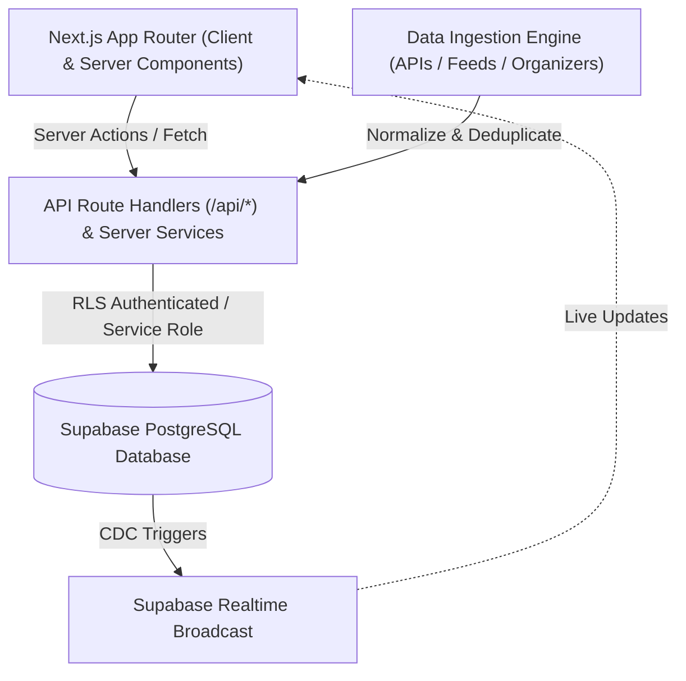

# TechOrbit Architecture Specification

## 1. System Overview
TechOrbit is structured as a **modular monolith** using the Next.js App Router (TypeScript, React 18+), Tailwind CSS, and Supabase (PostgreSQL with Row Level Security, Supabase Auth, Supabase Storage, and Realtime Broadcast).

## 2. Product Divisions
1. **TechOrbit Discover (Opportunity Radar)**: Global search, multi-faceted filtering (category, skill, eligibility, deadline, cost, format), opportunity detail, canonical official apply links, provenance attribution.
2. **TechOrbit Community & TeamMatch**: Teammate discovery, skill-based requests, team formation for specific hackathons/competitions, invitation management.
3. **TechOrbit Organizer Portal**: Organization creation, event publication lifecycle (Draft -> Submitted -> Approved -> Published), submission management, announcements, participant lists.
4. **TechOrbit Passport**: Developer identity profile, verified achievements, project portfolio, skill matrix, certificates, and privacy controls (public/private).
5. **TechOrbit Intelligence**: Rule-based matching engine, eligibility validation, skill-gap analysis, natural language search, and Opportunity Copilot recommendations.
6. **TechOrbit Live**: Online event participation, team workspaces, project submission with versioning, judging criteria scorecards, and live leaderboards.
7. **Participant Dashboard (My Activities)**: Journey tracker with states: Saved, Interested, Applied, Shortlisted, Accepted, Participating, Completed, Rejected, Withdrawn. Clear separation between self-reported and organizer-confirmed statuses.
8. **Admin Moderation & Data Health**: Verification approval queue, source health status, ingestion sync history, deduplication metrics, and audit logs.

## 3. Data Integrity & Provenance Triad
Every opportunity in TechOrbit tracks 3 independent dimensions:
- **Source**: `official_source` | `organizer_submitted` | `community_submitted`
- **Verification**: `verified` | `pending_review` | `rejected` | `community_unverified`
- **Freshness**: `recently_checked` | `needs_recheck` | `expired`
